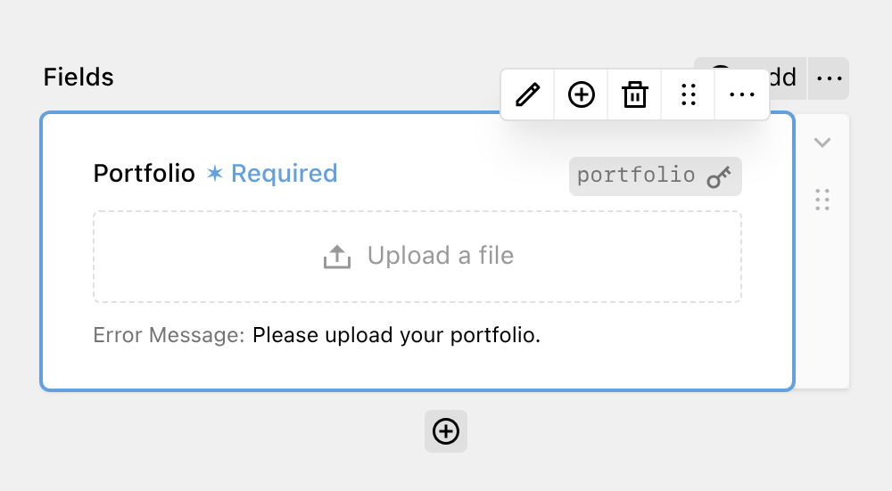

The File Upload allows your user to upload files like images, PDF documents, or archives with a form submission.



Clicking on the Edit button, you can customize the maximum file size and the allowed document types.

PHP has a maximum file size in the `php.ini` config that will take preference over the specified file size in the fields config. To increase it, set the `upload_max_filesize` & `post_max_size` to your desired values.

It's important to keep in mind that **uploaded files are not saved when storing submissions is disabled.** The field is still shown and validated, and actions in the same request, such as attachments of the [Email action](../3_actions/4_email.md), can still use the files.

## File types

In the **Validation** tab of the field, editors can select one or more file type groups in the **Limit File Types to…** option. An uploaded file is accepted if its MIME type is part of one of the selected groups. DreamForm detects the MIME type on the server from the uploaded file. If no group is selected, all file types are accepted.

By default, DreamForm comes with these groups:

| Group | Panel label | MIME types |
| --- | --- | --- |
| `images` | Images | `image/jpeg`, `image/png`, `image/gif`, `image/avif`, `image/webp` |
| `audio` | Audio | `audio/mpeg`, `audio/ogg`, `audio/opus`, `audio/aac`, `audio/wav`, `audio/webm` |
| `video` | Video | `video/x-msvideo`, `video/mp4`, `video/mpeg`, `video/ogg`, `video/webm` |
| `documents` | Documents | `application/pdf`, `application/msword`, `application/vnd.ms-excel`, `application/vnd.ms-powerpoint` |
| `archives` | Compressed Archives | `application/zip`, `application/x-rar-compressed`, `application/x-tar`, `application/x-7z-compressed` |

### Adding or changing groups

You can change the groups with the `fields.fileUpload.types` option. If you use the nested array form shown below, Kirby merges your config with the defaults: a new key adds a group, and an existing key replaces the MIME types of that group. All other default groups stay available. A flat key such as `'tobimori.dreamform.fields.fileUpload.types' => [...]` replaces all default groups.

```php
// site/config/config.php

return [
  'tobimori.dreamform' => [
    'fields' => [
      'fileUpload' => [
        'types' => [
          // add a new group
          'fonts' => ['font/woff', 'font/woff2', 'font/ttf', 'font/otf'],
          // replace the MIME types of a default group
          'documents' => [
            'application/pdf',
            'application/vnd.openxmlformats-officedocument.wordprocessingml.document'
          ]
        ]
      ]
    ],
  ],
];
```

To replace the full list of groups, set the option to a callback that returns the groups. A callback is not merged with the defaults.

```php
// site/config/config.php

return [
  'tobimori.dreamform' => [
    'fields' => [
      'fileUpload' => [
        'types' => fn () => [
          'images' => ['image/jpeg', 'image/png'],
          'documents' => ['application/pdf']
        ]
      ]
    ],
  ],
];
```

The panel label of a group comes from the translation key `dreamform.fields.upload.allowedTypes.<group>`. DreamForm only includes translations for the default groups. For custom groups, add the key with a plugin so the option has a label in the panel.

```php
// site/plugins/dreamform-types/index.php

Kirby::plugin('your-name/dreamform-types', [
  'translations' => [
    'en' => [
      'dreamform.fields.upload.allowedTypes.fonts' => 'Fonts'
    ]
  ]
]);
```

| Option | Default | Accepts | Description |
| --- | --- | --- | --- |
| tobimori.dreamform.fields.fileUpload.types | see above | `array|callback` | File type groups editors can select, as group key => list of MIME types |

## Protecting files

Since Kirby copies all files to the media folder, **they're publicly accessible by default.** If you're handling sensitive data, follow along. The Kirby documentation has great [Cookbook guide](https://getkirby.com/docs/cookbook/security/files-firewall) on how to protect files. You can adapt it to work with DreamForm files by checking for the `dreamform-upload` blueprint. In the end, it could look lke this:

```php
<?php

use Kirby\Toolkit\Str;
use Kirby\Uuid\Uuid;
use Kirby\Cms\App;

App::plugin('dreamform/files-firewall', [
  'routes' => [
    [
      'pattern' => '_form/(:any)',
      'action'  => function ($filename) {
        if (
          kirby()->user() &&
          $file = Uuid::for("file://{$filename}")?->model()
        ) {
          /** @var \Kirby\Cms\File $file */
          return $file->download();
        }

        return site()->errorPage();
      },
    ],
  ],
  'components' => [
    'file::url' => function ($kirby, $file) {
      if ($file->template() === 'dreamform-upload') {
        return $kirby->url() . '/_form/' . Str::replace($file->uuid()->toString(), 'file://', '');
      }

      return $file->mediaUrl();
    },
    'file::version' => function ($kirby, $file, array $options = []) {
      static $original;

      // if the file is protected, return the original file
      if ($file->template() === 'dreamform-upload') {
        return $file;
      }

      // if static $original is null, get the original component
      if ($original === null) {
        $original = $kirby->nativeComponent('file::version');
      }

      // and return it with the given options
      return $original($kirby, $file, $options);
    }
  ],
]);
```