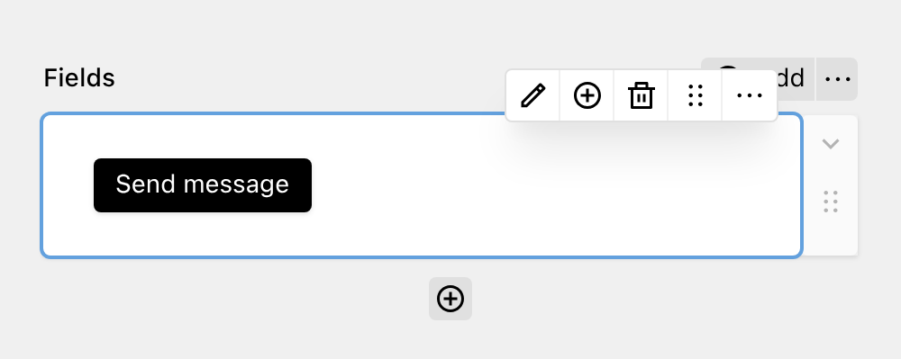

Button fields are used for form navigation and submission actions. They don't collect user input but provide interactive elements for users to navigate through forms or submit data.

The button submits the form, or in a [multi-step form](../0_general/2_multi-step.md), submits the current step and goes to the next one. It maps to a `<button type="submit">` element.

You can customize the label shown in the button. If you leave the label empty, the button shows the default label ("Submit" in English).

Each form step needs at least one Button field. Without it, users cannot submit the form or continue to the next step. DreamForm renders the guard inputs, such as the CSRF token, the honeypot and captcha widgets, before the last Button field of a step.
