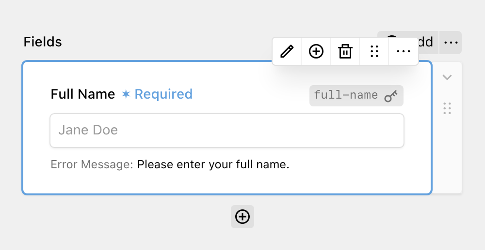

Text fields are used for capturing single-line text input from users. They map to standard HTML `<input type="text">` elements.

The Text field has options for setting the **Key**, a **Label** and the **Placeholder**. The Key is used as the `name` of the input and to store the value in the submission. It is generated from the Label until you change it manually or save the form. If another field already uses the generated key, a suffix such as `_2` is added.

Under the validation tab, you can also mark the field as **required** and add a **custom error message**. If you leave the error message empty, the default message "This field is required." is shown.

The Text field has no length or format validation. Use the [Email](5_email.md) or [Number](4_number.md) field if you need to validate the format of the input.
