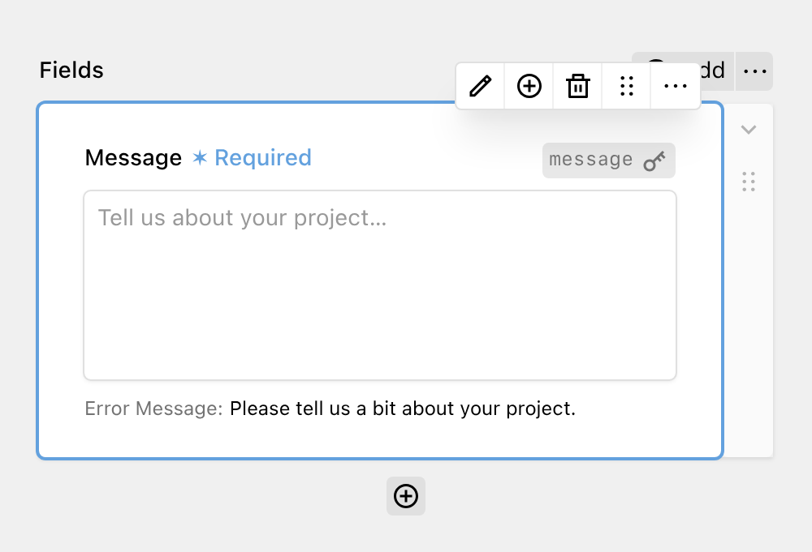

Multi-line text fields are used for capturing longer text input from users, like messages or comments. They map to HTML `<textarea>` elements.

The multi-line text field has the same options as a normal text field: Setting the Key, a Label and the Placeholder. Under the validation tab, you can also mark the field as required and add a custom error message. If you leave the error message empty, the default message "This field is required." is shown.
