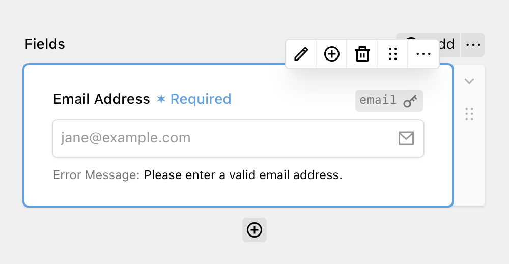

The Email field allows you to capture email addresses and validate them. It maps to a `<input type="email">` element. It is safe to use user-filled email fields to get the recipient inside an Email action.



The Email field has the same options as a normal text field: Setting the Key, a Label and the Placeholder. Under the validation tab, you can also mark the field as required and add a custom error message. This error message will also be shown if **the email is in an invalid format.**

## Additional validation

DreamForm runs two more checks on every non-empty email address after the format check. Both are enabled by default. If one of the checks fails, the sender sees the same error message as for an invalid format: the custom **Error Message** from the validation tab, or `This field is required.` if you did not set one.

### DNS lookup

DreamForm checks if the domain of the email address (the part after the `@`) has an MX record. Addresses on domains without an MX record are rejected, also if the domain could receive email through its A record. This check uses PHP's `checkdnsrr()` function, so your server needs to be able to resolve DNS records.

### Disposable email addresses

DreamForm rejects addresses from disposable email providers. It downloads a plain text list with one domain per line and compares it with the domain of the email address. Only exact, case-sensitive matches are rejected, so subdomains of a listed domain and domains with uppercase letters are not blocked.

By default, DreamForm uses the [disposable-email-domains](https://github.com/disposable/disposable-email-domains) list. You can set the URL of a different list with the same format.

The list is stored in the `tobimori.dreamform.fields` cache for 10 minutes. If you disable this cache, DreamForm downloads the list again for every validation. If the download does not return a `200` status code, DreamForm uses an empty list until the cache expires, and no address is rejected by this check. The cache key does not include the URL, so if you change `list`, the new list is used only after the cache expires or you clear it.

### Disabling the checks

Set the options to `false` in your `config.php` file to disable the checks.

```php
// site/config/config.php

return [
  'tobimori.dreamform' => [
    'fields' => [
      'email' => [
        'dnsLookup' => false,
        'disposableEmails' => [
          'disallow' => false,
        ],
      ],
    ],
  ],
];
```

## Options

| Option | Default | Accepts | Description |
| --- | --- | --- | --- |
| tobimori.dreamform.fields.email.dnsLookup | `true` | `boolean` | Whether the domain of the email address needs to have an MX record |
| tobimori.dreamform.fields.email.disposableEmails.disallow | `true` | `boolean` | Whether email addresses from disposable providers are rejected |
| tobimori.dreamform.fields.email.disposableEmails.list | `'https://raw.githubusercontent.com/disposable/disposable-email-domains/master/domains.txt'` | `string` | URL of a plain text list of disposable email domains, one domain per line |
