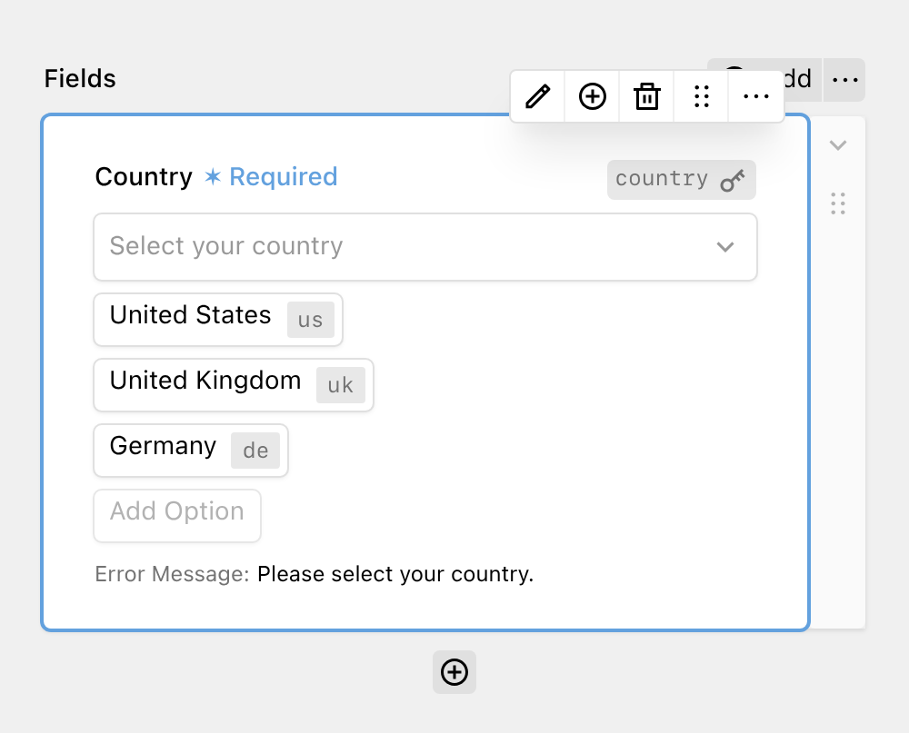

Select fields provide a dropdown menu for users to choose exactly one entry from a list of options. They map to HTML `<select>` elements.

Each option has a label and a value. The label is shown to the user, and the value is saved in the submission. You can add, edit, and sort the options directly in the block preview or in the sidebar when clicking on the Edit button.

Besides the options, you can set a key, a label, and a placeholder. The placeholder is shown as the first entry of the dropdown while no option is selected. Users cannot select it.

When switching to the validation tab, you can mark the field as **required** and set a custom **error message**. If you leave the error message empty, a default message ("This field is required." in English) is shown.

If you want to fill the dropdown with Kirby pages instead of entering each option by hand, use the [Pages field](9_pages.md).
