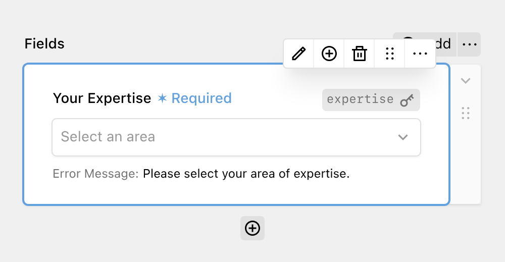

The Pages Dropdown automatically populates a dropdown with a selection of Kirby pages or the listed children of these pages.



Besides the normal options a [dropdown field](8_select.md) has, like label, key & placeholder, clicking on the edit button opens the sidebar where you can select pages to be shown in the dropdown. Alternatively, you can click the toggle and use the listed children of these pages instead.

## Configuring the page selection

The page query controls which pages editors can pick in the **Options** field in the panel. It is passed to the `query` option of Kirby's [pages field](https://getkirby.com/docs/reference/panel/fields/pages#query).

The query sets the pages shown at the top level of the page picker. Editors can still open these pages and select their subpages. By default, the picker shows all top-level pages and drafts of your site, except the DreamForm page that holds your forms (template `forms`):

```
site.childrenAndDrafts.filterBy("intendedTemplate", "!=", "forms")
```

You can change the query in your `config.php` file, e.g. to start the picker at the children of a specific page:

```php
// site/config/config.php

return [
  'tobimori.dreamform' => [
    'fields' => [
      'pages' => [
        'query' => 'page("products").children'
      ],
    ],
  ],
];
```

### Options

| Option | Default | Accepts | Description |
| --- | --- | --- | --- |
| tobimori.dreamform.fields.pages.query | `'site.childrenAndDrafts.filterBy("intendedTemplate", "!=", "forms")'` | `string|callback` | Kirby query for the pages editors can select in the panel |
