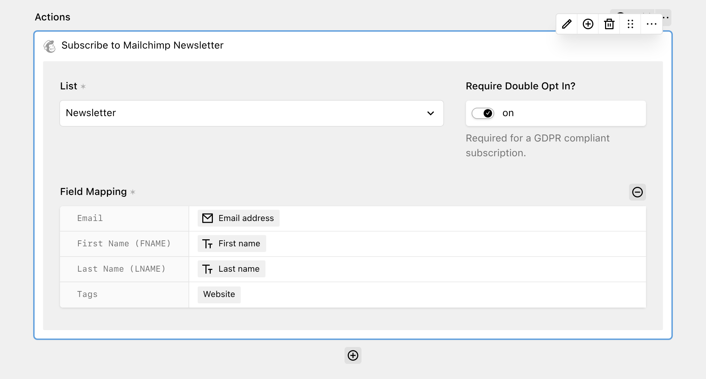

[Mailchimp](https://mailchimp.com/) is an email marketing platform for newsletters, automations and audience management.

With the Mailchimp action, you can connect DreamForm to your Mailchimp account and let senders subscribe to one of your audiences (called "lists" in the Mailchimp API and in the action settings).



## Get started

You need a Mailchimp account with at least one audience. Create an API key in your Mailchimp account under **Profile → Extras → API keys** and select **Create A Key**. See the [Mailchimp documentation on API keys](https://mailchimp.com/help/about-api-keys/) for more information. Add the key to your `config.php` file.

```php
// site/config/config.php

return [
  'tobimori.dreamform' => [
    'actions' => [
      'mailchimp.apiKey' => fn () => env('MAILCHIMP_API_KEY')
    ],
  ],
];
```

Ideally, you should not commit this key to your repository, but instead load it from an environment variable, e.g. using the [kirby-dotenv plugin by Bruno Meilick](https://github.com/bnomei/kirby3-dotenv), as shown in the example above.

Use the full key, including the data center suffix after the dash (e.g. `-us21`). DreamForm uses this suffix to build the API URL.

| Option | Default | Accepts | Description |
| --- | --- | --- | --- |
| tobimori.dreamform.actions.mailchimp.apiKey | `null` | `string|callback` | The API key used to communicate with Mailchimp |

The action is only available if the API key is set and Mailchimp accepts it. DreamForm checks the key with a request to the Mailchimp API and caches the result for 10 minutes. If the check fails, the action does not show up in the action selector.

## Adding the action to your form

If the API key is set and working, the **Subscribe to Mailchimp Newsletter** action will show up in the **Newsletter & Marketing** group of the action selector. Add it to your workflow and configure these options:

- **List**: The Mailchimp audience the sender is subscribed to. This option is required.
- **Require Double Opt In?**: If enabled, new contacts get the status "pending" and Mailchimp sends them a confirmation email. If disabled, new contacts are subscribed immediately. Double opt-in is required for a GDPR compliant subscription.
- **Field Mapping**: Connects your form fields to the fields of the selected audience. The mapping fields load when you select a list, and change when you select a different list.

### Field mapping

The field mapping contains these fields:

- **Email**: The email address to subscribe. This field is required. You can only select [Email fields](../2_fields/5_email.md) from your form.
- **Merge fields**: One field for each merge field of the audience, shown as `Name (TAG)`, e.g. `First Name (FNAME)`. Merge fields of the types `address`, `birthday`, `date` and `imageurl` are not supported and do not show up.
- **Tags**: Select **Static** to pick one or more existing tags of the audience, or **From User Input** to take the tags from a form field. A field value with more than one tag must be separated by commas.

For each email and merge field, you can select **From User Input** to use the value of a form field, or **Static** to enter a fixed value. Empty merge fields are not sent to Mailchimp. DreamForm sends the merge fields without merge field validation, so required merge fields in Mailchimp do not cause an error.

If the email address already exists in the audience, DreamForm updates the existing contact with the mapped values. The double opt-in setting only applies to new contacts. The subscription status of an existing contact does not change, so contacts who have unsubscribed are not subscribed again.

If you enable IP collection with the `tobimori.dreamform.metadata.collect` option (see [Configuration](../1_setup/2_configuration.md)), DreamForm sends the sender's IP address to Mailchimp as the sign-up IP. On multi-language sites, DreamForm also sends the code of the current language.

## Submission log and errors

After a successful request, the submission log shows the email address and the name of the list. DreamForm compares the sign-up time that Mailchimp returns with the current time. If the sign-up is not recent, the log entry says that the address is already subscribed.

The action handles these cases:

- If the email field is empty, the action does nothing and the workflow continues.
- If the email address is invalid, the submission is canceled and the sender sees the error "The email address for the subscription is invalid."
- If the Mailchimp API returns an error, the submission is canceled and the error message from Mailchimp is added to the submission log. The sender sees a generic error message, except when [debug mode](../1_setup/2_configuration.md) is enabled.

If "Continue submission on error" is enabled in the form settings, the workflow continues with the next action after an error.

The Mailchimp action supports background processing. If the workflow runs in a queue, errors do not change the response for the sender, because the sender already received the success message. See [Background actions](../5_developers/7_under-the-hood.md#background-actions) for more information.

## Caching

DreamForm caches the data from the Mailchimp API in the `tobimori.dreamform.performer` cache for 10 minutes. This includes the API key check, the lists, the merge fields and the tags of each list. If you add a list, merge field or tag in Mailchimp, it can take up to 10 minutes until it shows up in the Panel. Clear the Kirby cache to see the changes immediately.

The Panel loads the field mapping from the `dreamform/object/mailchimp` API route, which returns the merge fields and tags for the selected list.

## Limitations

- The action loads up to 1,000 lists, and up to 1,000 segments per list for the static tags.
- Merge fields of the types `address`, `birthday`, `date` and `imageurl` are not supported.
- The action loads only the first 10 merge fields of an audience, as DreamForm uses the default page size of the Mailchimp API. Unsupported merge fields count toward this limit.
