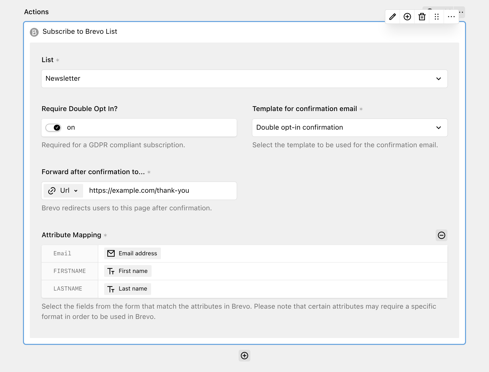

[Brevo](https://www.brevo.com/) (formerly Sendinblue) is a marketing platform for email campaigns, automations and transactional email.

With the Brevo action, you can connect DreamForm to your Brevo account and add senders as contacts to a Brevo list, with or without double opt-in.



## Get started

You need a Brevo account and an API key. In Brevo, open **Settings → SMTP & API → API Keys** and generate a new API key. Use an API key, not an SMTP key. Brevo explains this in their [API key documentation](https://developers.brevo.com/docs/api-key-authentication). Add the key to your `config.php` file.

```php
// site/config/config.php

return [
  'tobimori.dreamform' => [
    'actions' => [
      'brevo.apiKey' => fn () => env('BREVO_API_KEY')
    ],
  ],
];
```

Ideally, you should not commit this key to your repository. Load it from an environment variable instead, as shown in the example above.

| Option | Default | Accepts | Description |
| --- | --- | --- | --- |
| tobimori.dreamform.actions.brevo.apiKey | `null` | `string|callback` | The API key used to communicate with Brevo |

The action is only available if an API key is set. Without a key, it does not show up in the action selector.

### Authorized IPs

If you have enabled IP address restrictions in Brevo, Brevo blocks API requests from IP addresses that are not on the list. In this case, the action shows an **IP Authorization Required** message with the IP address of your server, and you cannot select a list. Add this IP address to your [authorized IPs](https://app.brevo.com/security/authorised_ips) in Brevo.

## Adding the action to your form

If the API key is set, the **Subscribe to Brevo List** action shows up in the **Newsletter & Marketing** group of the action selector. Add it to your workflow and configure these options:

- **List**: The Brevo list the contact is added to. This option is required.
- **Require Double Opt In?**: If enabled, Brevo sends a confirmation email first, and adds the contact to the list only after the contact confirms the subscription. This is required for a GDPR compliant subscription.
- **Template for confirmation email**: The Brevo email template used for the confirmation email. This option is shown and required when double opt-in is enabled. The select shows all transactional templates, but Brevo only accepts a double opt-in (DOI) template that contains the confirmation link. If your Brevo account has no such template, create one in Brevo first.
- **Forward after confirmation to...**: The URL, page or file Brevo redirects the contact to after the confirmation. This option is shown and required when double opt-in is enabled.
- **Attribute Mapping**: Connects your form fields to the contact attributes in Brevo.

## Attribute mapping

In **Attribute Mapping**, select **the field that contains the email address** you want to subscribe. Only email fields can be selected. You can also enter a static email address instead.

DreamForm also shows one entry for each text attribute in your Brevo account, such as `FIRSTNAME` or `LASTNAME`. Brevo attributes of other types and calculated attributes are not shown. Select the form field that contains the value for an attribute, or enter a static value. Empty values are not sent. Some attributes may require a specific format in Brevo.

If double opt-in is disabled and the contact already exists in Brevo, the existing contact is updated.

## Errors and logging

- If the email field is empty, the action does nothing.
- If the email address is invalid, the submission is canceled with the message "The email address for the subscription is invalid."
- If Brevo rejects the request, the submission is canceled. The error message from Brevo is saved in the submission log. Users see a generic error message, except if debug mode is enabled.
- If the IP address of your server is not authorized in Brevo, the submission is canceled and the error is saved in the submission log.

A successful subscription is saved in the submission log, for example "Subscribed jane@example.com to Newsletter". If you enable **Continue submission on error** in the form settings, the form shows a success message even if the action fails.

The action can run in the background if the form uses [background actions](../5_developers/7_under-the-hood.md#background-actions). In this case, errors only go to the logs, because the user already received the success message.

## Caching

DreamForm caches the lists, templates and attributes of your Brevo account for 10 minutes. If you add a list, template or attribute in Brevo, it can take up to 10 minutes until it shows up in the panel. The check for the IP authorization is not cached, but the empty result of a blocked request is. After you authorize the IP address in Brevo, it can take up to 10 minutes until your lists show up, unless you clear the cache.

## Limitations

- The action loads only the first 10 lists of your Brevo account, as DreamForm uses the default page size of the Brevo API.
