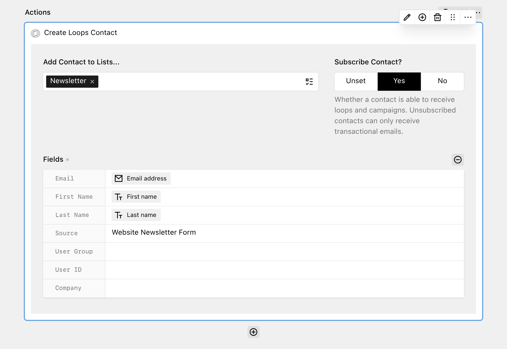

[Loops](https://loops.so/) is an email platform for SaaS companies to send product, marketing and transactional emails.

With the Loops action, you can connect DreamForm to your Loops account and add senders as contacts to your audience and mailing lists.



## Get started

You need a Loops account. Create an API key in Loops under **Settings → API** and click **Generate key**. See the [Loops API documentation](https://loops.so/docs/api-reference/intro#authentication) for more information. Add the key to your `config.php` file.

```php
// site/config/config.php

return [
  'tobimori.dreamform' => [
    'actions' => [
      'loops.apiKey' => fn () => env('LOOPS_API_KEY')
    ],
  ],
];
```

Ideally, you should not commit this key to your repository, but instead load it from an environment variable, e.g. using the [kirby-dotenv plugin by Bruno Meilick](https://github.com/bnomei/kirby3-dotenv), as shown in the example above.

| Option | Default | Accepts | Description |
| --- | --- | --- | --- |
| tobimori.dreamform.actions.loops.apiKey | `null` | `string|callback` | The API key used to communicate with Loops |

The action is only available if the API key is set and Loops accepts it. DreamForm checks the key with a request to the Loops API and caches the result for 10 minutes. If the check fails, the action does not show up in the action selector.

## Adding the action to your form

If the API key is set and working, the **Create Loops Contact** action will show up in the **Newsletter & Marketing** group of the action selector. Add it to your workflow and configure these options:

- **Add Contact to Lists...**: One or more Loops mailing lists the contact is added to. DreamForm only sends the selected lists, so other list subscriptions of an existing contact do not change.
- **Subscribe Contact?**: Whether the contact is able to receive loops and campaigns. Unsubscribed contacts can only receive transactional emails. Select **Yes** to subscribe the contact, or **No** to unsubscribe the contact. With **Unset**, DreamForm does not send the setting, so Loops keeps the current status of an existing contact and uses its default for new contacts.
- **Fields**: Connects your form fields to the contact properties in Loops. This option is required.

### Field mapping

The **Fields** option contains these fields:

- **Email**: The email address of the contact. This field is required.
- **First Name**, **Last Name**, **Source**, **User Group** and **User ID**: The default contact properties of Loops.
- **Custom properties**: One field for each custom contact property in your Loops account, shown with its label. Properties of the types `date` and `boolean` are not supported and do not show up. For properties of the type `number`, you can only select [Number fields](../2_fields/4_number.md) from your form.

For each field, you can select **From User Input** to use the value of a form field, or **Static** to enter a fixed value. Empty fields are not sent to Loops.

DreamForm sends the contact to the `/contacts/update` endpoint of the Loops API. If no contact with this email address exists, Loops creates a new contact. If the contact exists, Loops updates it with the mapped values.

## Submission log and errors

After a successful request, the submission log shows the message "The Loops contact has been created or updated" with the email address.

The action handles these cases:

- If the email address is empty or invalid, the submission is canceled and the sender sees the error "The email address for the subscription is invalid."
- If the Loops API returns an error, the submission is canceled and the error message from Loops is added to the submission log. The sender sees a generic error message, except when [debug mode](../1_setup/2_configuration.md) is enabled.

If "Continue submission on error" is enabled in the form settings, the workflow continues with the next action after an error.

The Loops action supports background processing. If the workflow runs in a queue, errors do not change the response for the sender, because the sender already received the success message. See [Background actions](../5_developers/7_under-the-hood.md#background-actions) for more information.

## Caching

DreamForm caches the data from the Loops API in the `tobimori.dreamform.performer` cache for 10 minutes. This includes the API key check, the mailing lists and the custom contact properties. If you add a mailing list or a custom property in Loops, it can take up to 10 minutes until it shows up in the Panel. Clear the Kirby cache to see the changes immediately.

## Limitations

- Custom contact properties of the types `date` and `boolean` are not supported.
- If you delete a custom property in Loops, DreamForm does not send its value anymore, also if the action still has a mapping for it.
