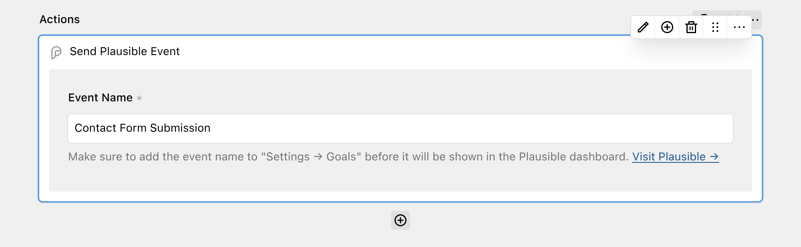

[Plausible](https://plausible.io/) is a privacy-friendly web analytics tool. It is available as a hosted service and as a self-hosted Community Edition.

With the Plausible action, DreamForm sends a custom event to Plausible each time a form is submitted. This lets you track form submissions as goals in your Plausible dashboard, without client-side JavaScript.



## Get started

The action uses the [Plausible Events API](https://plausible.io/docs/events-api). This API does not need an API key. You only need a Plausible site. Add the domain of your site, as it is set up in Plausible, to your `config.php` file.

The Events API requires the IP address and the user agent of the visitor. Configure DreamForm to collect both values:

```php
// site/config/config.php

return [
  'tobimori.dreamform' => [
    'actions' => [
      'plausible' => [
        'domain' => 'example.com'
      ]
    ],
    'metadata' => [
      'collect' => [
        'ip',
        'userAgent'
      ]
    ],
  ],
];
```

The action is only available if `domain` is set and `metadata.collect` contains both `'ip'` and `'userAgent'`. If one of them is missing, the action does not show up in the action selector.

### Self-hosted Plausible

If you host Plausible yourself, set `apiUrl` to the API URL of your instance. The value must end with `/api` and must not have a trailing slash. DreamForm sends the event to `{apiUrl}/event`.

```php
// site/config/config.php

return [
  'tobimori.dreamform' => [
    'actions' => [
      'plausible' => [
        'domain' => 'example.com',
        'apiUrl' => 'https://plausible.example.com/api'
      ]
    ],
    // metadata.collect is still required, see above
  ],
];
```

| Option | Default | Accepts | Description |
| --- | --- | --- | --- |
| tobimori.dreamform.actions.plausible.domain | `null` | `string|callback` | The domain of your site as set up in Plausible, required to enable the action |
| tobimori.dreamform.actions.plausible.apiUrl | `'https://plausible.io/api'` | `string|callback` | The API URL of the Plausible instance, change it for self-hosted instances |
| tobimori.dreamform.metadata.collect | `[]` | `array` | Must contain `'ip'` and `'userAgent'` to enable the action, see [Configuration](../1_setup/2_configuration.md) |

## Adding the action to your form

If the action is available, **Send Plausible Event** shows up in the **Analytics & Tracking** group of the action selector. Add it to your workflow and enter an **Event Name**, for example `Contact Form Submission`. The event name is required.

Plausible only shows custom events in the dashboard if a goal with the same name exists. Add the event name as a custom event goal under **Settings → Goals** in Plausible. See [the Plausible documentation on custom event goals](https://plausible.io/docs/custom-event-goals). The help text of the field links to the dashboard of your site.

## What is sent to Plausible

DreamForm sends one `POST` request to the Events API with these values:

- **`name`:** The event name from the action
- **`domain`:** The `domain` option
- **`url`:** The URL of the page that the form was submitted from. If DreamForm cannot get this page from the `Referer` header, it uses the site URL.
- **`X-Forwarded-For` header:** The IP address of the sender, from the submission metadata
- **`User-Agent` header:** The user agent of the sender, from the submission metadata

Plausible uses the IP address and the user agent to count unique visitors. The action does not send field values, custom properties or revenue data. The event name is static text and does not use field values.

## Errors

The action does not check the response from Plausible and does not add a log entry on success. If the request fails because of a connection error, DreamForm adds the error to the submission log and continues with the next action. The submission is not cancelled and the user still sees the success message.

## Queues

The action supports background processing. If the `tobimori\Queues` plugin is installed, and "Store Submissions" and "Run workflow in background" are enabled for the form, the event is sent in a queued job. The job builds the page URL from the Kirby `url` option, so set this option if your queue worker runs on the command line. The job uses the IP address and the user agent stored with the submission, so Plausible still receives the values of the sender. See [Under the Hood](../5_developers/7_under-the-hood.md#background-actions).

When you store submissions, the collected IP address and user agent are saved with each submission. Keep this in mind for your privacy policy, and see [Data Retention](../0_general/3_data-retention.md).
