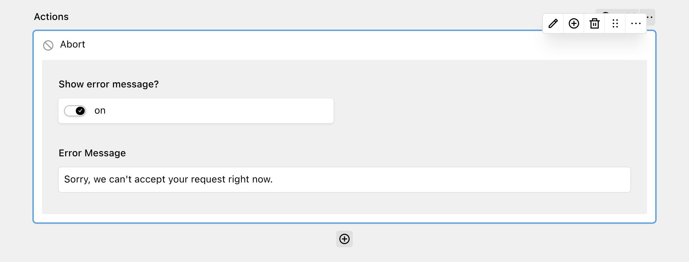

The Abort action allows you to stop form processing and cancel the submission under certain conditions. It either ends the submission early, or it cancels the submission and shows an error message to the user. Actions after the Abort action do not run.

The Abort action is most useful in combination with the [Conditional action](2_conditional.md). Put it inside a conditional action to stop the workflow only when the submitted values match your conditions.

## Options

| Option | Default | Description |
| --- | --- | --- |
| Show error message? | On | Cancels the submission and shows an error message to the user. Turn it off to end the submission early, with a success message. |
| Error Message | "Something went wrong. Please try again later." | The error message that the user sees. Only available when "Show error message?" is on. |

## Effect on the submission

**With "Show error message?" on**, the form shows the error message and the submission fails. DreamForm does not store the submission. If partial submissions are enabled, DreamForm stores the data as a partial submission.

**With "Show error message?" off**, the submission ends early as successful. DreamForm stores the submission (if storing submissions is enabled) and the form shows as successful, but the remaining actions do not run.

If you enable "Continue submission on error" in the form settings, the Abort action with an error message has no effect: the workflow continues with the next action.

The Abort action always runs immediately, also when the workflow runs in a queue. Because of this, it runs before all queued actions and can stop them.
