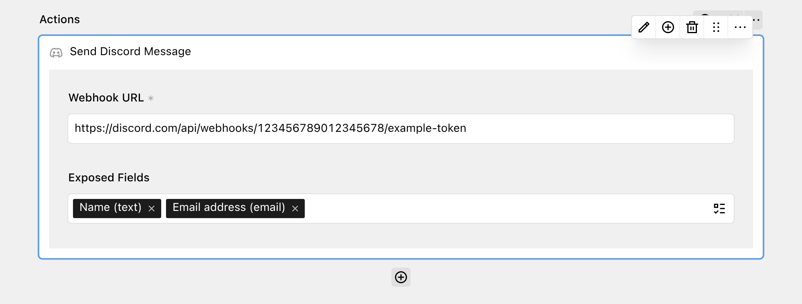

The Discord action allows you to send form submission data to Discord channels using Discord webhooks. Each submission is posted as a message to the channel of the webhook.



## Get started

Create a webhook for the Discord channel that should receive the messages and copy its URL. Discord explains how to do this in their [Intro to Webhooks](https://support.discord.com/hc/en-us/articles/228383668-Intro-to-Webhooks) guide.

## Adding the action to your form

Add the **Send Discord Message** action to your workflow and paste the webhook URL into the **Webhook URL** field. The URL must start with `https://discord.com/api/webhooks/`.

Use **Exposed Fields** to select the fields that should be included in the message. If no fields are selected, all fields are sent. Fields without a value are left out.

The message is sent as an embed with the form title, the label and value of each exposed field, the title of your site and the time of the submission. If Discord rejects the request, the submission is canceled.

## Default webhook URL

If all your forms post to the same channel, you can set a default webhook URL in your `config.php` file. The **Webhook URL** field in the panel then becomes optional, and the default is used for every Discord action that has no URL of its own.

```php
// site/config/config.php

return [
  'tobimori.dreamform' => [
    'actions' => [
      'discord.webhook' => fn () => env('DISCORD_WEBHOOK_URL')
    ],
  ],
];
```

Anyone with the webhook URL can post to your channel, so you should not commit it to your repository. Load it from an environment variable instead, as shown in the example above.

| Option | Default | Accepts | Description |
| --- | --- | --- | --- |
| tobimori.dreamform.actions.discord.webhook | `null` | `string|callback` | Default webhook URL used when the action has no URL set |
