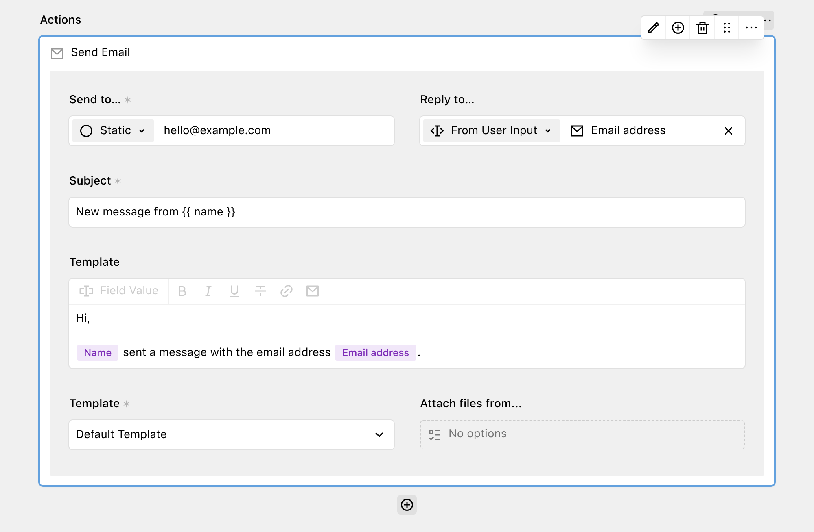

Using the email action, you can send email from the configured SMTP credentials of your Kirby installation to anyone. You can customize the sent message in the panel or use email templates defined in the code of your Kirby site.



Write the message in the **Template** text field. You can use field keys as placeholders in it, and in the **Subject**. A field with the key `name` is available with the placeholder `{{ name }}`. You can also insert field placeholders with the toolbar of the text field. The placeholders `{{ page.title }}`, `{{ page.url }}` and `{{ form.title }}` insert the title and URL of the page the form was submitted on and the title of the form. Placeholders do not support the Kirby Query Language.

The **Template** select chooses the email template that renders the message. If you leave the text field empty, the **Default Template** included with DreamForm lists the values of all fields, except file uploads.

To use your own email template, add it to `site/templates/emails` and select it in the **Template** select. Your template has access to `$body` (the message from the text field, as `html` and `text`, or `null` if the text field is empty), `$submission`, `$form` and `$action`.

## Sender address

DreamForm sends all emails from one sender address. You cannot change the sender in the panel. By default, DreamForm uses the `email.transport.username` option of your Kirby installation as the sender email and the title of your site as the sender name.

If your SMTP username is not a valid email address, or you want to use a different sender, set the sender in your `config.php` file.

```php
// site/config/config.php

return [
  'tobimori.dreamform' => [
    'actions' => [
      'email' => [
        'from' => [
          'email' => 'forms@example.com',
          'name' => 'My Website'
        ]
      ]
    ],
  ],
];
```

| Option | Default | Accepts | Description |
| --- | --- | --- | --- |
| tobimori.dreamform.actions.email.from.email | `fn () => App::instance()->option('email.transport.username')` | `string|callback` | The email address used as sender |
| tobimori.dreamform.actions.email.from.name | `fn () => App::instance()->site()->title()` | `string|callback` | The name used as sender |

If the sender email or name is empty, the action fails and the user sees an error message. The error "No sender email or transport username specified" is added to the submission log, but you only see it if the submission is stored, for example with partial submissions or "Continue submission on error".

The **Reply to…** field in the panel does not change the sender. It sets the reply-to address of the email. If you leave it empty, the sender email is used as the reply-to address.
