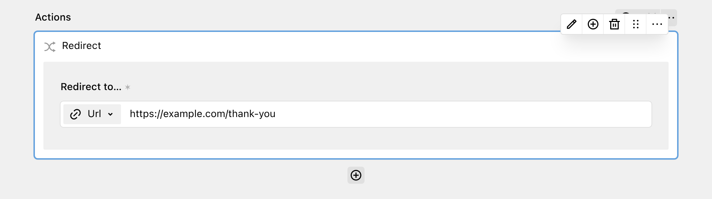

The Redirect action allows you to redirect users to a specific URL or page after successful form submission. Use it to send users to a success page instead of showing the success message from the form settings.



The **"Redirect to…"** field is required. You can select a URL, a page, or a file of your site as the target.

For multi-step forms, actions run after the last step. If more than one Redirect action runs, the last one sets the target. The Redirect action always runs immediately, also when the workflow runs in a queue.

In `prg` mode, the redirect only happens when the submission is successful. In `htmx` and `api` mode, the target is used even if a later action fails. To prevent a redirect after a failed action, put the Redirect action at the end of the workflow.

## Redirect based on field values

The Redirect action is especially useful together with the [Conditional action](2_conditional.md). Put Redirect actions inside a Conditional action to send users to different pages based on their answers.

## Submission modes

How the redirect reaches the browser depends on the [submission mode](../1_setup/2_configuration.md):

* `prg`: DreamForm responds with a normal HTTP redirect to the target.
* `htmx`: DreamForm responds with an empty body and an `HX-Redirect` header. HTMX then loads the target page.
* `api`: DreamForm does not redirect. The JSON response contains the target in the `redirect` key, which is `null` when no Redirect action ran. Your client-side script must follow the redirect.

```js
const data = await response.json();

if (data.success && data.redirect) {
  window.location.href = data.redirect;
}
```
